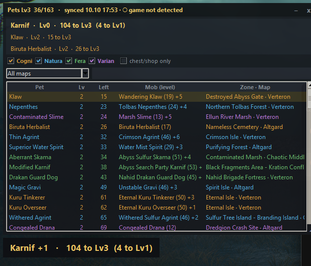

# Aion 2 Pet Overlay

A lightweight always-on-top overlay for **Aion 2 (Global)** that shows which pets are still short
of level 3, and tells you exactly how many souls are left every time you pick one up.



## Features

- **Live soul counter**: every soul you loot pops a toast like `Klaw +1 · 15 to Lv3 (4 to Lv2)`.
  It turns green when the pet hits Lv3, and warns you if you keep farming a pet that's already maxed.
- **"Farming now" panel** with the last three pets you collected souls for.
- **Full checklist** of every unfinished pet: souls left, the best mob to farm (plus how many other
  mobs drop it), and the zone and map where that mob spawns most.
- **Filters**: by genus (Cogni, Natura, Fera, Varian), by map, or by free-text search across pet,
  mob and zone names. Click any column header to sort.
- **Remembers your progress** between sessions, so you only need a fresh sync when something drifts.
- Collapses to a thin title bar when you want it out of the way.

## Is it safe?

Short version: **it reads, it never writes, and there is still a risk.**

- The overlay only *listens* to the traffic the game server sends to your PC, the same way packet-based
  DPS meters do. It doesn't inject anything into the game, read or modify game memory, send input,
  or talk to the game servers.
- It makes no internet connections at all while running. Everything stays on your machine.
- That said, NCSOFT's terms of service prohibit unauthorized third-party programs, and NCSOFT has not
  approved this tool. **Use it at your own risk.** If that's a dealbreaker, don't install it.

## Requirements

- Windows 10 or 11
- [Npcap](https://npcap.com/#download), installed with the default options. If you already use a
  packet-based DPS meter or Wireshark, you probably have it.
- Aion 2 running in **windowed** or **borderless** mode. Overlays can't draw on top of exclusive fullscreen.

## Download

1. Download **`Aion2PetOverlay.exe`** from the [latest release](https://github.com/MartinLVila/aion2-pet-overlay/releases/latest).
2. Put it in its own folder, since it saves your progress next to itself.

The exe isn't code-signed, so Windows may push back on first launch:

- **SmartScreen** ("Windows protected your PC"): click **More info → Run anyway**.
- **Smart App Control** ("This app has been blocked"): Windows doesn't let you allow a single app,
  so [run from source](#run-from-source) instead.

Every release is built and tested by [GitHub Actions](.github/workflows/release.yml) straight from
this repo's source, and ships with a `SHA256SUMS.txt` so you can verify the download.

### Run from source

If you'd rather not run an unsigned exe, or Smart App Control blocks it:

1. Install [Python](https://www.python.org/downloads/) 3.11 or newer (tick *"Add python.exe to PATH"*).
2. Download this repo (**Code → Download ZIP**) and extract it anywhere.
3. Open a terminal in that folder and run, once:

   ```
   python -m venv .venv
   .venv\Scripts\python -m pip install -r requirements.txt
   ```

4. From then on, start it with **`start.bat`**.

## Usage

1. Start **`Aion2PetOverlay.exe`** (or `start.bat` if you run from source).
2. Log in and **enter the world** with your character. When you enter the world the server sends
   your progress for every pet, and the title bar switches to `synced`. If the game was already
   running, go back to character select and enter the world again.
3. Go farm. The list and the toasts update as you loot souls.

| Control | Action |
| --- | --- |
| Drag the title bar | Move the overlay |
| `–` | Collapse / expand |
| `x` | Close (saves position and filters) |
| `◢` (bottom-right corner) | Resize |
| Column header | Sort by that column |
| *chest/shop only* | Also show pets with no soul-dropping mob |

## Troubleshooting

| What you see | What to do |
| --- | --- |
| `waiting for sync` | The overlay hasn't seen your progress yet. Go to character select and enter the world again. |
| `game not detected` | The game process (`AION2.exe`) isn't running, or the overlay can't see its connections. |
| `Npcap missing` | Install [Npcap](https://npcap.com/#download) and restart the overlay. |
| `Capture failed` | Run `start.bat` as administrator. Npcap may have been installed with "admin-only" access. |
| Counts drift from the in-game pet window | Re-enter the world to resync. In-game numbers always win. |
| A toast says `Pet 1234` instead of a name | A patch added new pets. Refresh the data (see below) or open an issue. |
| Overlay hidden behind the game | Switch the game to windowed or borderless mode. |

Errors are written to `pet_overlay.log` next to the exe (or the scripts). Please attach it when you report a bug.

## Region support

Built and tested on the **Global** servers, where pets cap at level 3 (5 → 25 → 75 souls, 105 total).
Korean and Taiwanese servers have more pet levels and may use different packets, so they aren't
supported yet.

## How it works

`pet_protocol.py` passively captures the game's TCP traffic with Npcap and decodes two server
messages:

| Opcode | Sent when | Contains |
| --- | --- | --- |
| `0x0090` | You enter the world | Level and current souls for every pet |
| `0x0D90` | You loot a soul | Pet ID and souls gained |

Frames are LZ4-compressed in bundles. The decoder reassembles the TCP stream, unpacks them, and
keeps a running count between full syncs. `pet_overlay.py` is a small Tkinter UI on top of that.

### Updating pet data

Pet names, genus, best mob, mob level and spawn zone live in `data/pets.json`. After a patch that
adds pets, regenerate it with:

```
.venv\Scripts\python tools\build_pets.py
```

It fetches about one page per second, so it takes a few minutes. To check the decoder and UI without
the game running:

```
.venv\Scripts\python selftest.py
```

To build the exe yourself, run `build.ps1`. It builds with PyInstaller, then runs the same checks inside
the exe with `Aion2PetOverlay.exe --selftest`.

## Contributing

Bug reports and pull requests are welcome. Packet formats can change with game patches, so if the
overlay stops syncing after an update, an issue with your `pet_overlay.log` is the most useful thing
you can send.

## Support & contact

If the overlay saves you some farming time and you'd like to say thanks, you can
[buy me a coffee on PayPal](https://paypal.me/mytzuo). Completely optional, and very appreciated.

Found a bug or have an idea? [Open an issue](https://github.com/MartinLVila/aion2-pet-overlay/issues)
so others can find it too. For anything else, I'm **mytzuo** on Discord.

## Credits

- Protocol research and the original decoder:
  [elkaida/AION2-pet-tracker](https://github.com/elkaida/AION2-pet-tracker) (MIT).
  `pet_protocol.py` is adapted from their work.
- Pet, monster and spawn data: [MetaBot.GG](https://metabot.gg/en/aion-2/mounts), used under their
  attribution terms. Source page for `data/pets.json`: <https://metabot.gg/en/aion-2/mounts>.

## Disclaimer

This is an unofficial fan project. It is not affiliated with, endorsed by, or supported by NCSOFT or
MetaBot.GG. AION is a trademark of NCSOFT Corporation.

## License

[MIT](LICENSE)
